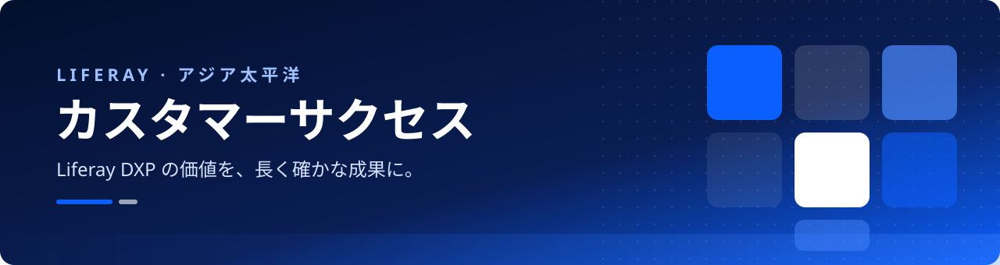

  <a href="https://github.com/LGSAPAC">English</a> | <b>日本語</b>

  

  
  
  

  <b>Liferay アジア太平洋地域のカスタマーサクセスチームです。</b> 
  初期導入からその後のアップグレードまで、お客様に寄り添い、Liferay DXP がビジネスの成果を生み出し続けられるよう支援しています。

---

## 私たちの取り組み

<table>
  <tr>
    <td width="80" align="center" valign="top"></td>
    <td valign="top">
      <h3>1 · オンボーディングと活用定着</h3>
      Liferay の価値をいち早く実感していただけるよう支援します。キックオフ時に明確な目標を設定し、それに基づくサクセスプランを作成したうえで、プラットフォームの活用定着に向けてお客様のチームをサポートします。
    </td>
  </tr>
  <tr>
    <td align="center" valign="top"></td>
    <td valign="top">
      <h3>2 · 技術アドバイザリーとヘルスチェック</h3>
      アーキテクチャ、設定、パフォーマンス、カスタマイズを Liferay のベストプラクティスに照らしてレビューし、優先順位を付けた明確な改善計画をご提示します。
    </td>
  </tr>
  <tr>
    <td align="center" valign="top"></td>
    <td valign="top">
      <h3>3 · アップグレード、移行、ライフサイクル管理</h3>
      Liferay の四半期リリースへの追従を支援します。アップグレードの計画や既存プラットフォームからのコンテンツ移行を行い、サポート対象の安全なバージョンを維持できるようにします。
    </td>
  </tr>
  <tr>
    <td align="center" valign="top"></td>
    <td valign="top">
      <h3>4 · イネーブルメントとナレッジ共有</h3>
      アジア太平洋地域のプロジェクトで得た知見を、実践的なガイド、サンプルコード、再利用可能なツールとして共有し、お客様のチームが自信を持って開発できるよう支援します。
    </td>
  </tr>
  <tr>
    <td align="center" valign="top"></td>
    <td valign="top">
      <h3>5 · パートナーシップと成果の可視化</h3>
      長期的なパートナーとしてお客様に伴走します。定期的なビジネスレビューでお客様にとって重要な成果を確認し、必要なときには地域内の適切な Liferay の専門家におつなぎします。
    </td>
  </tr>
</table>

---

## 📚 チュートリアルとサンプルコード

この Organization では、アジア太平洋地域での実際のお客様プロジェクトから生まれた Liferay DXP 向けの**チュートリアル、サンプルコード、ツール**を公開しています。主な内容は次のとおりです。

- 一般的な実装作業やアップグレード作業のステップバイステップのチュートリアル
- お客様の Liferay ワークスペースで再利用できるサンプルプロジェクトとコード
- 移行・自動化ツール

新しいコンテンツは随時追加していきます。

## 🔔 最新情報を受け取る

最新のチュートリアルやサンプルを受け取るには、次の方法をご利用ください。

1. **[@LGSAPAC](https://github.com/LGSAPAC) をフォロー**すると、新しいリポジトリや更新情報が GitHub のフィードに表示されます。
2. 関心のあるリポジトリを **Watch**（**Watch → Custom → Releases**）すると、更新時に通知が届きます。
3. 役に立ったリポジトリに **Star ⭐** を付けておくと、あとから簡単に見つけられます。

## 💬 お問い合わせ

ご質問や詳しい内容については、お気軽にお問い合わせください。

  
   
  <a href="https://www.liferay.co.jp/contact">https://www.liferay.co.jp/contact</a>

---

Liferay カスタマーサクセス · アジア太平洋

