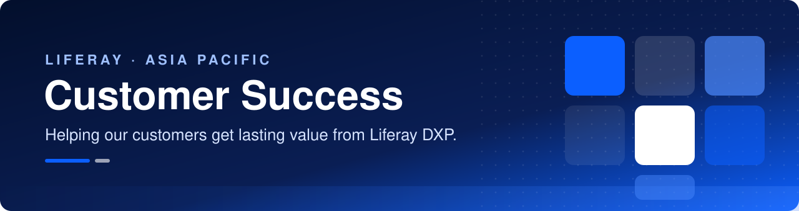
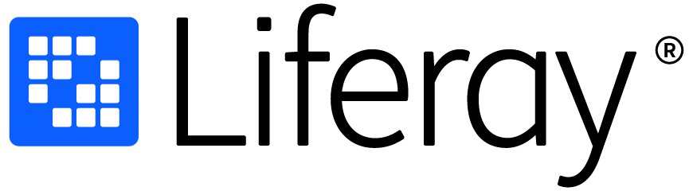

  

  
  
  

  <b>We're the Liferay Customer Success team for Asia Pacific.</b> 
  We work with customers from first deployment through every upgrade after it, so that Liferay DXP keeps delivering results for your business.

  <b>Liferay アジア太平洋地域のカスタマーサクセスチームです。</b> 
  初期導入からその後のアップグレードまで、お客様に寄り添い、Liferay DXP がビジネスの成果を生み出し続けられるよう支援しています。

---

## How we work · 私たちの取り組み

<table>
  <tr>
    <td width="80" align="center" valign="top"></td>
    <td valign="top">
      <b>Onboarding &amp; adoption</b> · オンボーディングと活用定着 
      Clear goals, a success plan, and support as your teams adopt Liferay. 
      明確な目標設定とサクセスプランで、Liferay の活用定着を支援します。
    </td>
  </tr>
  <tr>
    <td align="center" valign="top"></td>
    <td valign="top">
      <b>Technical advisory &amp; health checks</b> · 技術アドバイザリーとヘルスチェック 
      Best-practice reviews of your environment, with a prioritized plan for what to improve. 
      ベストプラクティスに基づいて環境をレビューし、優先順位を付けた改善計画をご提示します。
    </td>
  </tr>
  <tr>
    <td align="center" valign="top"></td>
    <td valign="top">
      <b>Upgrades, migrations &amp; lifecycle</b> · アップグレード、移行、ライフサイクル管理 
      Upgrade planning, content migration, and staying on a supported, secure version. 
      アップグレード計画やコンテンツ移行を支援し、サポート対象の安全なバージョンを維持します。
    </td>
  </tr>
  <tr>
    <td align="center" valign="top"></td>
    <td valign="top">
      <b>Enablement &amp; knowledge sharing</b> · イネーブルメントとナレッジ共有 
      Hands-on guidance, sample code and reusable tooling for Liferay DXP. 
      Liferay DXP の実践的なガイド、サンプルコード、ツールを共有します。
    </td>
  </tr>
  <tr>
    <td align="center" valign="top"></td>
    <td valign="top">
      <b>Partnership &amp; measurable value</b> · パートナーシップと成果の可視化 
      Regular business reviews, and the right Liferay experts whenever you need them. 
      定期的なビジネスレビューで成果を確認し、適切な Liferay の専門家におつなぎします。
    </td>
  </tr>
</table>

  👉 <b>More details:</b> <a href="https://lgsapac.github.io/#how-we-work">lgsapac.github.io</a> &nbsp;·&nbsp; <b>詳しくはこちら：</b><a href="https://lgsapac.github.io/ja/#how-we-work">lgsapac.github.io/ja</a>

---

## 📚 Tutorials & sample code · チュートリアルとサンプルコード

We publish tutorials, sample code and tools for Liferay DXP, written by our team for common implementation, upgrade and migration tasks. New material is added regularly.

一般的な実装、アップグレード、移行作業に役立つ Liferay DXP 向けのチュートリアル、サンプルコード、ツールを、私たちのチームが作成して公開しています。新しいコンテンツは随時追加していきます。

➡️ [Browse resources](https://lgsapac.github.io/#resources) · [リソースを見る](https://lgsapac.github.io/ja/#resources)

## 🔔 Stay up to date · 最新情報を受け取る

- **Follow [@LGSAPAC](https://github.com/LGSAPAC)** to see new repositories in your GitHub feed. · フォローすると、新しいリポジトリが GitHub のフィードに表示されます。
- **Watch** repositories you're interested in (**Watch → Custom → Releases**) to be notified of updates. · リポジトリを Watch すると、更新時に通知が届きます。
- **Star ⭐** repositories you find useful. · 役に立ったリポジトリには Star を付けてください。

## 💬 Questions? · お問い合わせ

If you have questions or would like more detail, please get in touch. · ご質問や詳しい内容については、お気軽にお問い合わせください。

  
  

---

  <a href="https://www.liferay.com/">
    <picture>
      <source media="(prefers-color-scheme: dark)" srcset="assets/liferay-logo-white.png">
      
    </picture>
  </a>

Liferay Customer Success · Asia Pacific · カスタマーサクセス アジア太平洋 · <a href="https://lgsapac.github.io/">lgsapac.github.io</a>

